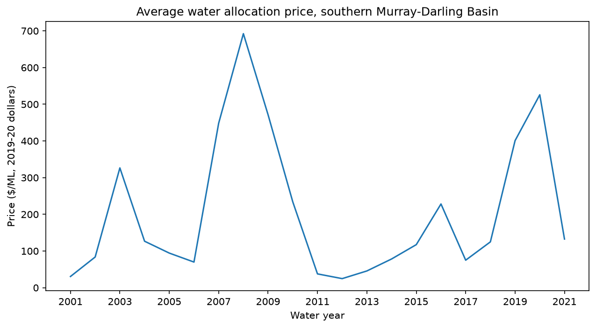
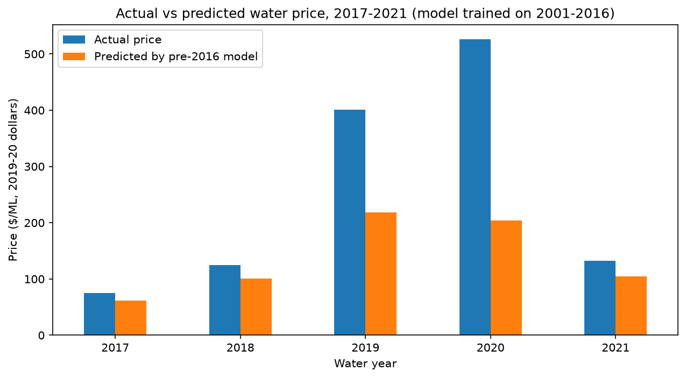

# Murray-Darling Water Market Analysis
What drives water allocation prices in Australia's southern Murray-Darling Basin?
Building on ABARES's 2000–2016 analysis, this project examines whether the same
fundamentals still explain prices today.

# Murray-Darling Water Market Analysis

**What drives water prices in Australia's southern Murray-Darling Basin, and has the market changed since 2016?**

Australia runs one of the world's largest water markets: irrigators buy and sell water
allocations every season. This project builds on ABARES's 2000–2016 analysis of allocation
prices and tests whether the same fundamentals still explain prices in 2017–2021.

## Key findings

- **Prices follow water scarcity.** They peaked during the Millennium Drought (about AUD 690/ML
  in 2008), fell to about AUD 25/ML after the 2010–11 floods, and rose again during the
  2017–2019 drought (about AUD 525/ML in 2020).
- **After 2016, water costs about 90% more at comparable conditions.** Holding allocations,
  rainfall, carryover and region constant, prices are about 91% higher in 2017–2021
  (panel regression with region fixed effects, p < 0.001 with year-clustered standard errors).
- **A model trained on 2001–2016 underpredicts 2017–2021 prices by about 91% on average**,
  with the largest gaps in the 2019 and 2020 drought years.
- **The level of prices changed, not their sensitivity to water** (Chow-type test on slopes, p = 0.16).
- **Environmental water recovery explains about one third of the post-2016 premium.** Using
  effective allocations (net of entitlements held by the environment) reduces the premium
  from about 91% to about 56%.





## Data

- Source: ABARES, *Murray-Darling Basin Water Market Catchment Dataset 2021* (supply tables),
  CC BY 4.0. https://doi.org/10.25814/wvk8-5n34
- Panel of 9 southern regions × 21 water years (2000–01 to 2020–21) = 189 observations.
  Years are water years ending in June (2008 = July 2007 to June 2008).
- Prices are annual average allocation prices in real 2019–20 dollars, as cleaned by ABARES.

## Method

1. **Exploration** (`notebooks/01_explore.ipynb`): southern regions, price trends,
   price vs allocation, before and after 2016.
2. **Data preparation**: model variables only, small negative carryover values set to zero,
   log price, post-2016 indicator, carryover share and effective allocations.
   Saved to `data/processed/model_data.csv`.
3. **Models** (`notebooks/02_model.ipynb`):
   - OLS of log price on high and low reliability allocations, log rainfall, carryover share
     and a post-2016 indicator, with region fixed effects and year-clustered standard errors
   - Chow-type test: do the slopes differ after 2016?
   - Out-of-sample test: train on 2001–2016, predict 2017–2021
   - Same model with effective allocations

## Results

| Model | Post-2016 effect | R² |
|---|---|---|
| Allocations, rainfall, carryover | +90% | 0.56 |
| + region fixed effects | +91% | 0.67 |
| Effective allocations instead of raw allocations | +56% | 0.66 |
| Out-of-sample: actual vs predicted, 2017–2021 | +91% | 0.69 (training) |

## Related work

- ABARES (c. 2020) estimated that water recovery under the Basin Plan raised southern MDB
  allocation prices by about AUD 47/ML on average over 2005–06 to 2018–19, and that almond
  demand added about AUD 25/ML.
- The ACCC's Murray-Darling Basin water markets inquiry (final report, March 2021) reviewed
  how these markets work.
- Loch and Adamson (2021) found no evidence that hoarding or speculation drove recent price
  rises, pointing instead to drought and demand from permanent crops.

This project points in the same direction: environmental recovery explains part of the
post-2016 premium, and the rest is consistent with stronger demand from permanent crops,
which this dataset does not measure.

## Limitations

- Annual data, with only 45 observations after 2016: tests have limited power.
- The post-2016 indicator captures everything that changed after 2016, not one specific cause.
- Demand drivers (crop mix, commodity prices) are not in the model.
- Effective allocations rely on ABARES estimates of environmental holdings.
- Results show associations, not causal effects.

## Next steps (version 2)

- Extend the data beyond 2021 and test whether the premium persists
- Interactive dashboard with a scenario simulator
- Price scenarios for next season (dry, average, wet)

## Reproduce

```bash
git clone https://github.com/imadramdani-prog/murray-darling-water-market.git
cd murray-darling-water-market
python3 -m venv .venv
source .venv/bin/activate
pip install -r requirements.txt
```

Then run `notebooks/01_explore.ipynb` and `notebooks/02_model.ipynb`.

## Author

Imad Ramdani, BAA student in Finance and Data Science, HEC Montréal.