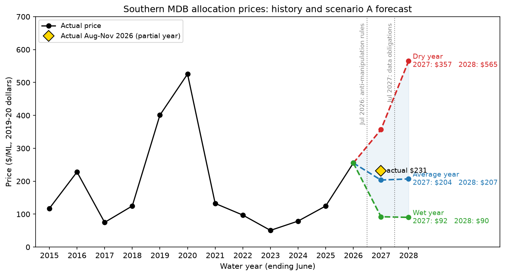
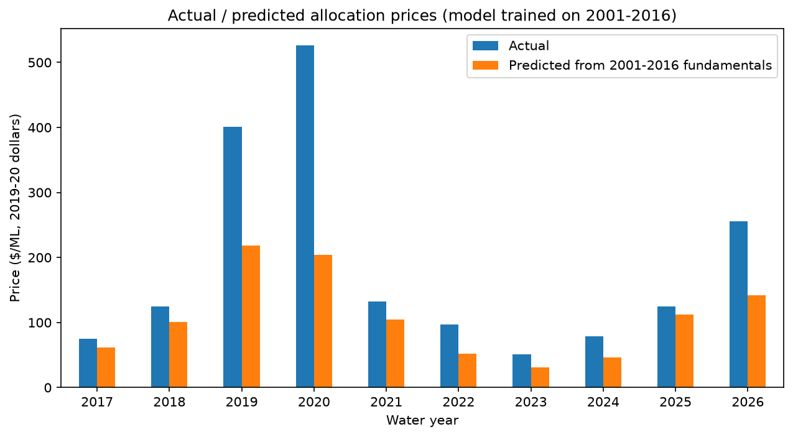
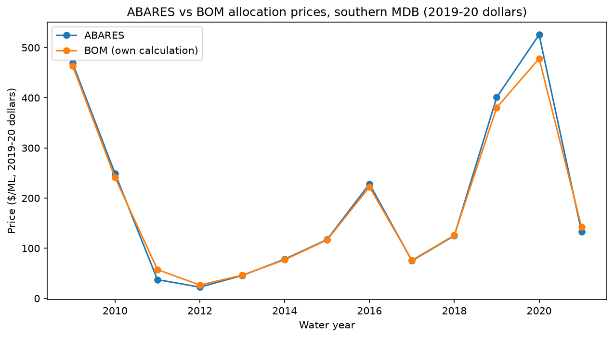

# Murray-Darling Water Market Analysis

**What drives water prices in Australia's southern Murray-Darling Basin, and has the market changed since 2016?**

Australia runs one of the world's largest water markets: irrigators, governments and investors buy and
sell water allocations every season. This project builds on ABARES's analysis of allocation prices,
tests whether the same fundamentals still explain prices after 2016, and extends the data to 2026.

**Live dashboard:** [murray-darling-water-market.streamlit.app](https://murray-darling-water-market.streamlit.app)
(price history, actual vs predicted prices, 2026-28 forecast and a price simulator).

## Key findings

**Version 1 (ABARES data, 2001-2021)**

- **Prices follow water scarcity.** They peaked during the Millennium Drought (about AUD 690/ML in 2008),
  fell to about AUD 25/ML after the 2010-11 floods, and rose again in the 2017-2019 drought
  (about AUD 525/ML in 2020).
- **After 2016, water costs about 90% more at comparable conditions.** Holding allocations, rainfall,
  carryover and region constant, prices are about 91% higher in 2017-2021 (panel regression with region
  fixed effects, p < 0.001 with year-clustered standard errors).
- **A model trained on 2001-2016 underpredicts 2017-2021 prices by about 91% on average.**
- **The level of prices changed, not their sensitivity to water** (Chow-type test on slopes, p = 0.16).
- **Environmental water recovery explains about one third of the premium**: using effective allocations
  (net of entitlements held for the environment) reduces it from about 91% to about 56%.

**Version 2 (data extended to 2026)**

- **The new price series matches ABARES.** Prices rebuilt from Bureau of Meteorology trade records track
  ABARES closely over 2009-2021 (correlation 0.99, median gap -0.4%, 108 region-years).
- **The post-2016 premium persists.** At comparable allocations, rainfall and carryover, prices were about
  96% higher in 2017-2021 and about 88% higher in 2022-2026 than in 2001-2016 (p < 0.001 for both).
  The two premiums are not statistically different (p = 0.83): the premium held through the wet years
  2022-2024 and the dry years 2025-2026.
- **Scenario A forecast** (model trained on data up to June 2026, before the new market rules):
  AUD 92/ML (wet year), 204 (average) and 357 (dry) for 2026-27. The actual average price for
  August-November 2026 is AUD 231/ML, between the average and dry scenarios.







All prices are in real 2019-20 Australian dollars per megalitre (ML). Years are water years ending in
June (2026 = July 2025 to June 2026).

## Data

| Data | Source | Years |
|---|---|---|
| Prices, allocations, carryover, rainfall, environmental holdings | ABARES, [MDB Water Market Catchment Dataset 2021](https://doi.org/10.25814/wvk8-5n34) (CC BY 4.0) | 2001-2021 |
| Allocation trades (488,877 trades) | Bureau of Meteorology, [Water Markets Dashboard](https://www.bom.gov.au/water/dashboards/#/water-markets/mdb/at) (full extract) | 2008-2026 |
| Consumer price index (deflator) | Australian Bureau of Statistics, CPI Table 17 (quarterly) | 2008-2026 |
| Allocations and carryover, NSW | WaterNSW [WaterInsights](https://waterinsights.waternsw.com.au/) | 2022-2027 |
| Allocations, Victoria | [Northern Victoria Resource Manager](https://nvrm.net.au/resources-and-data/historical-allocation-data) | 2022-2027 |
| Carryover, Victoria | Victorian Water Accounts; Goulburn-Murray Water annual water outlooks | 2022-2026 |
| Allocations, South Australia | SA Department for Environment and Water | 2022-2027 |
| Rainfall | [SILO](https://www.longpaddock.qld.gov.au/silo/) (Queensland Government), one town per region | 2008-2026 |

The 2022-2027 allocations and carryover, with the source of each value, are in
`data/raw/supply_2022_2027.csv`. The BOM trade file (128 MB) is not stored in the repository: download
it from the dashboard ("Download data (Full Extract)") into `data/raw/Allocation_Trades.csv`.

## Method

1. **Exploration** (`notebooks/01_explore.ipynb`): southern regions, price trends, before and after 2016.
2. **Version 1 models** (`notebooks/02_model.ipynb`): OLS of log price on high and low reliability
   allocations, log rainfall, carryover share and a post-2016 indicator, with region fixed effects and
   year-clustered standard errors; Chow-type test; out-of-sample test (train 2001-2016, predict
   2017-2021); effective allocations.
3. **Extending the data** (`notebooks/03_extend.ipynb`):
   - BOM trades: southern MDB, surface water, prices between AUD 5 and 2,000/ML (237,808 trades kept);
     trading zones mapped to the 9 ABARES regions.
   - Prices rebuilt with the ABARES method: monthly volume-weighted prices, averaged over August to May,
     converted to 2019-20 dollars with the ABS CPI; checked against ABARES over 2009-2021.
   - Rainfall summed over August to May and scaled to ABARES levels for each region
     (correlation with ABARES 0.95).
   - Everything combined into `data/processed/panel_2001_2027.csv`.
4. **Extended model and forecast** (`notebooks/04_extended_model.ipynb`): separate premiums for 2017-2021
   and 2022-2026; out-of-sample test to 2026; scenario A forecast for 2026-27 and 2027-28 using each
   region's 10th, 50th and 90th percentile of rainfall and allocations (dry, average, wet), with 2026-27
   allocations no lower than those already announced.
5. **Dashboard** (`app.py`, Streamlit).

## Results

| Model | Post-2016 effect | R² |
|---|---|---|
| Allocations, rainfall, carryover (2001-2021) | +90% | 0.56 |
| + region fixed effects | +91% | 0.67 |
| Effective allocations instead of raw allocations | +56% | 0.66 |
| Extended model (2001-2026): premium 2017-2021 | +96% | 0.63 |
| Extended model (2001-2026): premium 2022-2026 | +88% | 0.63 |

| Scenario A forecast (AUD/ML, 2019-20 dollars) | Wet | Average | Dry |
|---|---|---|---|
| 2026-27 | 92 | 204 | 357 |
| 2027-28 | 90 | 207 | 565 |

## Related work

- ABARES estimated that water recovery under the Basin Plan raised southern MDB allocation prices by about
  AUD 47/ML on average over 2005-06 to 2018-19, and that almond demand added about AUD 25/ML.
- The ACCC's Murray-Darling Basin water markets inquiry (final report, March 2021) found no evidence of
  market power or price manipulation by investors, but described a market with little regulation of
  intermediaries and no trade surveillance.
- Loch and Adamson (2021) found no evidence of hoarding in 2017-2020.
- New rules: insider trading and market manipulation in water markets are prohibited from 1 July 2026,
  and new water market data obligations start on 1 July 2027.

This project agrees that environmental recovery explains part of the premium. The rest is not explained
by allocations, rainfall or carryover. Possible drivers include demand from permanent crops and investor
behaviour, which public data do not allow to test: trade records do not say who buys and who holds water.

## Limitations

- Annual data: tests after 2016 rest on few observations per region.
- The period indicators capture everything that changed after 2016, not one specific cause.
- Demand drivers (crop mix, commodity prices) are not in the model.
- From 2022, entitlements and the environmental share are held at 2020-21 levels.
- Some 2022-2026 carryover values are estimated (Victorian Murray 2023-2024, Loddon-Campaspe 2026).
- In NSW, 2022-2027 allocations are credited volumes divided by entitlements, slightly below announced
  allocations in wet years.
- 2026-27 is a partial year (prices August-November 2026, allocations announced by early November).
- Results show associations, not causal effects.

## Reproduce

```bash
git clone https://github.com/imadramdani-prog/murray-darling-water-market.git
cd murray-darling-water-market
python3 -m venv .venv
source .venv/bin/activate
pip install -r requirements.txt
```

Download the BOM trade file (see Data), then run the notebooks in order (01 to 04). In notebook 03, put
your email address in the SILO cell (`EMAIL = "YOUR_EMAIL"`): SILO uses it as a username. Launch the dashboard with `streamlit run app.py`.

## Author

Imad Ramdani, BBA student in Finance and Data Science, HEC Montréal.
